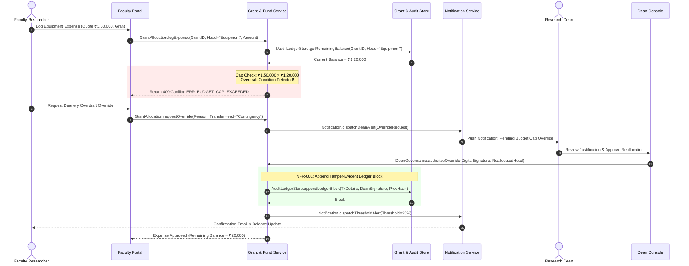
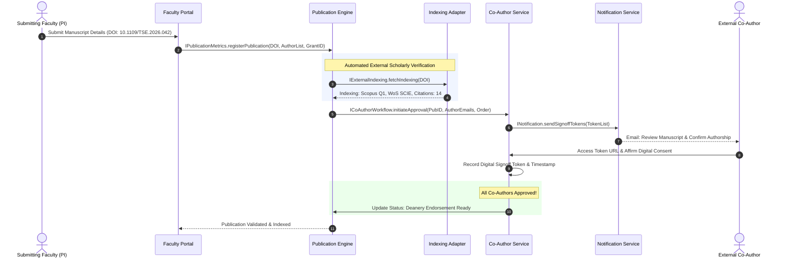

# Architectural Specification Document
## Faculty Research Grant & Publication Tracker
**Component Architecture & Interface Catalog**  
**Document Version:** 1.0.0  
**UML Standard:** UML 2.5 Component & Assembly Diagram

---

## 1. Architecture Overview

The **Faculty Research Grant & Publication Tracker** architecture adopts a modular, service-oriented component model designed for high cohesion, low coupling, and robust data integrity. The portal boundary encapsulates domain microservices, responsive web consoles, and external integration adapters.

The architecture emphasizes:
1. **Decoupled Governance**: Separates Faculty submission interfaces from Deanery authorization consoles.
2. **Cryptographic Financial Integrity**: Directs all fund modifications through an append-only, tamper-evident audit ledger.
3. **Resilient Scholarly Integration**: Isolates third-party academic citation and indexing engines behind dedicated adapter interfaces.
4. **Autonomous Event Dispatching**: Decouples status notifications and budget threshold alerts from core synchronous workflows.

---

## 2. Component Catalog & Responsibilities

The system is organized into **nine core components** distributed across three operational tiers:

### Tier 1: Client Experience & Orchestration Layer (Top Row)

#### 1. Faculty Portal (`Faculty Portal`)
- **Stereotype:** `<<component>>`
- **Role:** Web and mobile frontend interface tailored for Faculty Principal Investigators (PIs), Co-PIs, and research scholars.
- **Key Responsibilities:**
  - Submit sponsored research grant proposals and budget line items.
  - Log equipment procurement expenses, attach vendor quotations, and upload invoices.
  - Track real-time grant balance and categorized budget head availability.
  - Register publication metadata, manuscript DOIs, and initiate co-author approvals.
- **Associated Interfaces:** Requires `IGrantAllocation`, Provides user interactions.

#### 2. Grant & Fund Service (`Grant & Fund Service`)
- **Stereotype:** `<<component>>`
- **Role:** Central domain orchestrator managing the business logic of research grants, financial transactions, and compliance policies.
- **Key Responsibilities:**
  - Evaluates expense claims against remaining budget caps in real time.
  - Strictly prevents unauthorized overdrafts.
  - Orchestrates Deanery administrative override workflows.
  - Dispatches financial events to the immutable audit ledger.
  - Bridges grant deliverables to publication outputs.
- **Associated Interfaces:** Provides `IGrantAllocation`, `IDeanGovernance`; Requires `IPublicationMetrics`, `IAuditLedgerStore`, `ICoAuthorWorkflow`.

#### 3. Dean Console (`Dean Console`)
- **Stereotype:** `<<component>>`
- **Role:** Executive command and control console for the Research Dean and administrative officers.
- **Key Responsibilities:**
  - Review, evaluate, and formally endorse sponsored grant proposals.
  - Grant administrative budget cap overrides with cryptographic signatures and fund reallocation.
  - Release milestone-dependent grant fund tranches.
  - Inspect cross-departmental research productivity, burn velocity, and audit logs.
- **Associated Interfaces:** Requires `IDeanGovernance`.

---

### Tier 2: Domain Engines & Persistence Layer (Middle Row)

#### 4. Publication & Metrics Engine (`Publication Engine`)
- **Stereotype:** `<<component>>`
- **Role:** Specialized domain engine managing scholarly outputs, bibliographic metadata, and citation tracking.
- **Key Responsibilities:**
  - Validates and ingests Digital Object Identifiers (DOIs).
  - Associates publications with sponsoring research grants and faculty profiles.
  - Coordinates with external indexing adapters to verify Scopus, SCI, and Web of Science indexings.
  - Computes author and institutional h-index and citation trajectories.
- **Associated Interfaces:** Provides `IPublicationMetrics`; Requires `IExternalIndexing`.

#### 5. Grant & Audit Store (`Grant & Audit Store`)
- **Stereotype:** `<<component>>`
- **Role:** Dual-tier persistent data store combining relational grant structures with an immutable, append-only cryptographic ledger.
- **Key Responsibilities:**
  - Stores grant proposals, approved allocations, vendor profiles, and expense invoices.
  - Maintains a SHA-256 Merkle-linked audit ledger for all financial approvals and journal status modifications.
  - Provides cryptographic proof of non-repudiation and tampering detection for institutional audits.
- **Associated Interfaces:** Provides `IAuditLedgerStore`; Requires `IBurnUpAnalytics`.

#### 6. Co-Author Approval Service (`Co-Author Service`)
- **Stereotype:** `<<component>>`
- **Role:** Multi-party digital consent and workflow state machine.
- **Key Responsibilities:**
  - Manages the lifecycle of publication review requests (`Draft` -> `Pending Review` -> `Approved` / `Disputed` -> `Deanery Endorsed`).
  - Generates secure, one-time cryptographic signoff tokens for internal and external co-authors.
  - Logs author affirmations regarding authorship order, contribution percentages, and affiliations.
- **Associated Interfaces:** Provides `ICoAuthorWorkflow`; Requires `INotification`.

---

### Tier 3: Adapters & Analytics Layer (Bottom Row)

#### 7. External Indexing Adapter (`Indexing Adapter`)
- **Stereotype:** `<<component>>`
- **Role:** Resilient external integration gateway connecting the portal to global scientific indexing databases.
- **Key Responsibilities:**
  - Queries Scopus API, Web of Science (Clarivate) API, CrossRef REST API, and OpenAlex.
  - Implements circuit breaker patterns, exponential backoff, and localized caching.
  - Normalizes heterogeneous external citation data into canonical internal schemas.
- **Associated Interfaces:** Provides `IExternalIndexing`.

#### 8. Burn-Up Analytics Engine (`Burn-Up Analytics`)
- **Stereotype:** `<<component>>`
- **Role:** High-performance analytical calculation engine for financial burn velocity and predictive modeling.
- **Key Responsibilities:**
  - Analyzes historical spend trajectories across grants and departments.
  - Generates burn-up curves (cumulative planned expenditure vs. actual spend vs. scope).
  - Performs linear regression forecasting to project fund depletion dates (runout velocity).
  - Flags grants at risk of premature fund exhaustion or end-of-cycle fund lapse.
- **Associated Interfaces:** Provides `IBurnUpAnalytics`.

#### 9. Notification Service (`Notification Service`)
- **Stereotype:** `<<component>>`
- **Role:** Asynchronous multi-channel messaging service.
- **Key Responsibilities:**
  - Dispatches automated in-app alerts, transactional emails, and SMS notifications.
  - Sends immediate notifications when cumulative budget spend reaches 75%, 90%, and 100% caps.
  - Dispatches co-author signoff invitations, review reminders, and Deanery decision notices.
- **Associated Interfaces:** Provides `INotification`.

---

## 3. Interface Catalog (Ball-and-Socket Assembly Connectors)

All component interactions are strictly specified using UML Assembly Connectors (ball/lollipop representing provided interface, socket representing required interface):

| Interface Name | Provider Component | Requiring Component | Direction & Payload Signature | Functional Mapping |
| :--- | :--- | :--- | :--- | :--- |
| **`IGrantAllocation`** | `Grant & Fund Service` | `Faculty Portal` | `expense claim + procurement quote -> Balance & Cap Check <-` | **FR-001, FR-007, FR-009** |
| **`IDeanGovernance`** | `Grant & Fund Service` | `Dean Console` | `cap override + fund approval <-> policy decision` | **FR-002, FR-008** |
| **`IPublicationMetrics`** | `Publication Engine` | `Grant & Fund Service` | `grant link + manuscript DOI -> citation & indexing check <-` | **FR-003, FR-010** |
| **`IAuditLedgerStore`** | `Grant & Audit Store` | `Grant & Fund Service` | `read/write grants, append-only tamper ledger` | **FR-001, NFR-001, FR-012** |
| **`ICoAuthorWorkflow`** | `Co-Author Service` | `Grant & Fund Service` | `co-author review request <-> digital signoff token` | **FR-005** |
| **`IExternalIndexing`** | `Indexing Adapter` | `Publication Engine` | `DOI query -> Scopus, WoS & CrossRef citations` | **FR-004, NFR-007** |
| **`IBurnUpAnalytics`** | `Burn-Up Analytics` | `Grant & Audit Store` | `historical spend + milestones -> velocity & runout <-` | **FR-006, FR-010** |
| **`INotification`** | `Notification Service` | `Co-Author Service` | `status event + alert trigger -> delivery result <-` | **FR-011, FR-005** |

---

## 4. Key Architectural Workflows & Data Flows

### Workflow A: Equipment Procurement & Overdraft Protection (FR-001, FR-002, NFR-001)

---

### Workflow B: Manuscript Submission, External Indexing & Co-Author Signoff (FR-003, FR-004, FR-005)

---

## 5. Non-Functional Architecture Tactics

### 1. Tamper-Evident Ledger Integrity (NFR-001)
- Every transaction block $B_i$ contains:
  $$H_i = \text{SHA-256}(H_{i-1} \parallel \text{Timestamp} \parallel \text{GrantID} \parallel \text{Amount} \parallel \text{ActorRole} \parallel \text{DeanSignature})$$
- Continuous background validation worker verifies that $H_i$ matches recomputed hash from genesis block $B_0$.
- Any unauthorized direct manipulation of relational rows immediately triggers a cryptographic hash mismatch and locks the affected grant until verified by the Dean.

### 2. Peak Load Latency Optimization (NFR-002)
- Read-heavy analytics (Burn-up curves, faculty publication rosters) are cached in an in-memory Redis cluster with a 5-minute TTL.
- Write-heavy procurement checks utilize optimistic locking with Redis distributed locks (`Redlock`) to prevent concurrent race-condition overdrafts.

### 3. Fault-Tolerant External API Integration (NFR-007)
- Invocations to Scopus/WoS APIs are wrapped in a `Resilience4j` / Polly Circuit Breaker:
  - Threshold: 5 consecutive failures trips circuit breaker to `OPEN` for 60 seconds.
  - Fallback: Returns cached citation metrics with a `sync_status = STALE_CACHED` badge.
  - Rate Limiter: Capped at 10 requests/second to honor publisher API quotas.

---

## 6. Technology Mapping

| Layer / Component | Recommended Technology Stack | Justification |
| :--- | :--- | :--- |
| **Frontend Consoles** (`Faculty Portal`, `Dean Console`) | Next.js 14 (React) + TypeScript + Tailwind CSS / Vanilla CSS | Server-side rendering (SSR) for fast load times; strictly typed components. |
| **Microservices Backend** (`Grant & Fund`, `Publication Engine`) | Spring Boot 3.2 / Node.js NestJS + TypeScript | High enterprise concurrency, rich security ecosystem, standard REST/gRPC support. |
| **Data Storage & Ledger** (`Grant & Audit Store`) | PostgreSQL 16 (JSONB, ACID) + ImmuDB / TimescaleDB | Relational integrity for grants; cryptographically verified append-only ledger for transactions. |
| **External Integration** (`Indexing Adapter`) | Python FastAPI / Node.js Axios with Redis Cache | High asynchronous I/O performance for concurrent third-party HTTP queries. |
| **Analytics Engine** (`Burn-Up Analytics`) | Python NumPy / Pandas / Go Analytics Worker | Vectorized mathematical operations for linear regression and burn-up projection. |
| **Event Broker & Alerts** (`Notification Service`) | Apache Kafka / RabbitMQ + SendGrid & Twilio | High-throughput decoupled event streaming and asynchronous multi-channel delivery. |
