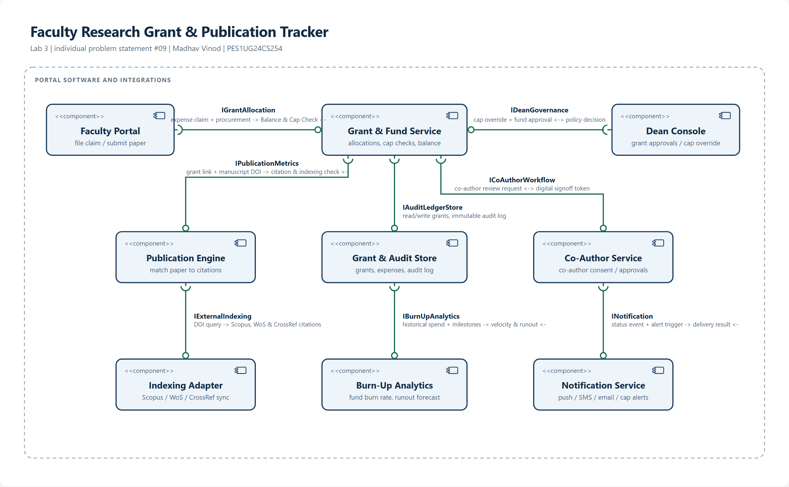

# Architectural Diagram
## Faculty Research Grant & Publication Tracker
**UML 2.5 Component & Assembly Diagram**

---

### Component Architecture Overview

This diagram represents the software component architecture for the **Faculty Research Grant & Publication Tracker** portal. It employs UML 2.5 component and assembly connector notation (ball-and-socket) connecting 9 modular components across 3 operational tiers:

1. **Faculty Portal** (`Faculty Portal`): Web console for faculty researchers to log procurement expenses, upload quotations/invoices, track remaining balances, and submit manuscript metadata.
2. **Grant & Fund Service** (`Grant & Fund Service`): Central domain orchestrator enforcing budget caps, validating expense limits, and executing financial business rules.
3. **Dean Console** (`Dean Console`): Administrative dashboard for grant approvals, budget cap overrides, and institutional governance.
4. **Publication Engine** (`Publication Engine`): Manages scholarly outputs, matches papers to grants, and computes citation metrics.
5. **Grant & Audit Store** (`Grant & Audit Store`): High-integrity data tier containing relational grant records and an append-only, SHA-256 tamper-evident ledger (fulfilling **NFR-001**).
6. **Co-Author Service** (`Co-Author Service`): State machine coordinating multi-party digital author consent and dispute detection.
7. **Indexing Adapter** (`Indexing Adapter`): Resilient external gateway with circuit breakers connecting to Scopus, Web of Science, and CrossRef.
8. **Burn-Up Analytics** (`Burn-Up Analytics`): Statistical engine calculating historical spend velocity and linear regression runout forecasting.
9. **Notification Service** (`Notification Service`): Asynchronous multi-channel messaging service for 75%/90%/100% budget threshold alerts and co-author prompts.

---

### Available Files
- `architecture_diagram.png`: High-resolution rendered diagram image.
- `architecture_diagram.svg`: Scalable vector graphic diagram.
- `architecture_diagram.html`: Interactive browser viewer.
- `ARCHITECTURE_SPECIFICATION.md`: Detailed component catalog, sequence flows & tech stack.
