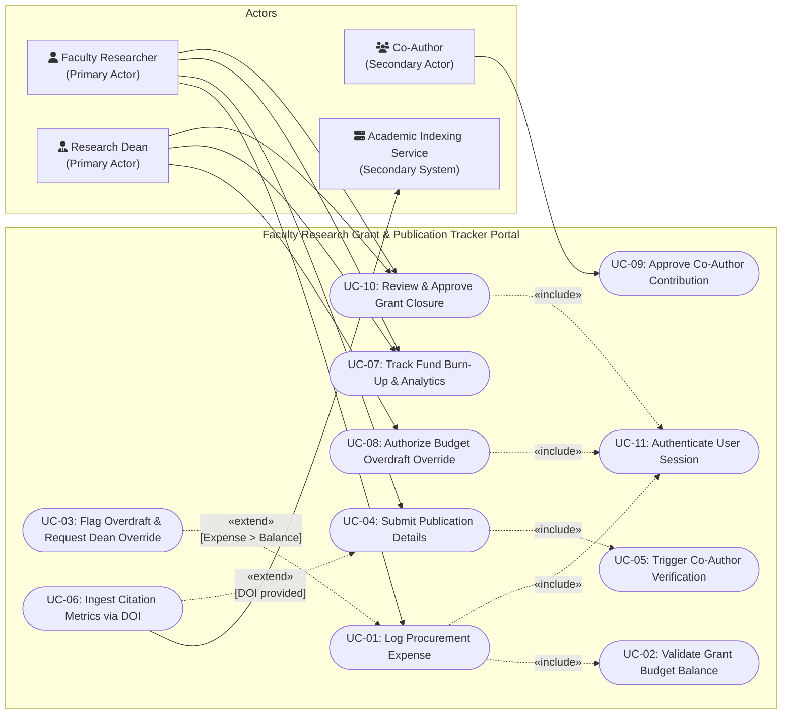

# Problem Statement #09: Faculty Research Grant & Publication Tracker
**PES University - Department of Computer Science & Engineering**  
**Lab 1: Requirements Engineering & UML Use-Case Modelling**  
**Domain:** Campus & Academic Operations  

---

The [requirements table](requirements_table.docx) and [procurement diagram](procurement_use_case.png) accompany the original [complete PlantUML model](use_case_diagram.puml). The [problem statement handout](../7_SE_Lab1_SE_Problem_Statements.pdf) is in the repository root.

## 1. Problem Context & Overview
The research deanery requires an automated portal to track sponsored research grants, faculty publication metrics (indexing, citations), co-author approval workflows, and fund burn-up analytics.

### Target Stakeholders & Actors
- **Faculty Researcher (Primary Actor):** Principal Investigators (PIs) and co-investigators who manage allocated grants, log procurement and research expenses, submit publications, and track research metrics.
- **Research Dean (Primary Actor / Reviewer):** Academic administrator overseeing institutional research output, approving budgetary overdraft overrides, monitoring aggregate burn-up analytics, and approving final grant closures.
- **Faculty Co-Author (Secondary Actor):** Internal or external academic collaborators required to digitally verify authorship and validate contribution claims prior to publication indexing.
- **Academic Indexing Service (Secondary System Actor):** External database APIs (Scopus, Web of Science, Crossref, IEEE Xplore) integrated to fetch citation metrics and verify DOI indexing status.

---

## 2. Requirements Specifications

### 2.1 Complete Functional Requirements Table (FR-001 to FR-005)

| ID | Requirement Category | Description | Priority | Acceptance Criteria | Rationale |
|---|---|---|---|---|---|
| **FR-001** | Grant Management & Budget Tracking | The system shall track grant fund allocations, allow faculty researchers to log equipment procurement expenses with itemized receipts, and automatically compute remaining budgetary balances across grant expenditure heads. | **High** | **Pass:** Budget balance updates accurately in real-time upon expense entry; system blocks non-authorized expense entries that exceed grant line-item or total budgetary caps.<br>**Fail:** Expense logged without deduction from available balance, or overdraft allowed without authorized administrative override. | Ensures financial discipline and compliance with sponsor agency funding limits by preventing unauthorized budgetary overruns. |
| **FR-002** | Publication & Workflow Management | The system shall manage faculty publication submissions by routing manuscript drafts and authorship metadata to all listed co-authors for mandatory digital sign-off and approval before indexing. | **High** | **Pass:** System automatically notifies all co-authors via authenticated portal links; publication status advances to "Verified" only when 100% of co-authors submit consent; logs timestamped approvals.<br>**Fail:** Publication is indexed or credited to faculty profile while co-author approvals are pending or if a co-author rejects attribution. | Eliminates ghost authorship and ethical disputes by guaranteeing multi-party verification prior to institutional accreditation. |
| **FR-003** | Publication Metrics & Indexing | The system shall automatically fetch, parse, and synchronize publication metadata and citation metrics (h-index, i10-index, Scopus/Web of Science/IEEE indexing tiers) using DOI lookups and academic database APIs. | **Medium** | **Pass:** System successfully resolves valid DOIs to populate journal name, impact factor, indexing status, and citation count within 5 seconds; schedules automated weekly citation refresh.<br>**Fail:** Invalid DOI accepted without error prompt; citation metrics fail to update or corrupt existing publication records. | Reduces manual data entry overhead for faculty and provides the research deanery with up-to-date institutional research impact metrics. |
| **FR-004** | Financial Analytics & Reporting | The system shall generate interactive fund burn-up analytics, projected expenditure velocity curves, and milestone-vs-expenditure comparative reports for active sponsored grants. | **High** | **Pass:** Research Dean dashboard visualizes periodic fund utilization trends, burn rate vs project timeline, and triggers early-warning alerts for grants with < 20% remaining funds or under-utilization near fiscal year-end.<br>**Fail:** Analytics report displays desynchronized financial data or fails to project milestone runway. | Enables research administrators and principal investigators to proactively manage grant timelines and avoid forfeiture of unspent sponsored funds. |
| **FR-005** | Grant Auditing & Lifecycle Closure | The system shall facilitate grant closure by compiling a consolidated Utilization Certificate (UC), statement of expenditure (SOE), associated publication deliverables, and routing the bundle to the Research Dean for formal sign-off. | **Medium** | **Pass:** System verifies that all logged expenses are reconciled, generates compliant UC/SOE PDF bundles with digital audit stamps, and transitions grant status to "Closed/Archived" upon Dean approval.<br>**Fail:** Grant closure permitted with unreconciled pending expense claims or missing deliverable attachments. | Standardizes statutory institutional reporting requirements for funding agencies and ensures full audit readiness. |

---

### 2.2 Complete Non-Functional Requirements Table (NFR-001 & NFR-002)

| ID | NFR Type | Description | Priority | Acceptance Criteria | Rationale |
|---|---|---|---|---|---|
| **NFR-001** | Security & Auditability | The system shall maintain an immutable, tamper-evident audit ledger recording all financial approvals, expense overrides, publication approvals, and journal status modifications with cryptographic checksums and user attribution. | **High** | **Pass:** Every financial modification and approval creates an append-only log entry containing User ID, UTC Timestamp, Action Type, Previous Value, New Value, and SHA-256 integrity hash; logs cannot be altered or deleted even by administrators.<br>**Fail:** Audit records can be updated, deleted, or bypassed during administrative overrides. | Meets institutional governance, external financial compliance, and anti-fraud regulations for sponsored research funds. |
| **NFR-002** | Performance & Scalability | The system shall execute fund burn-up analytics queries and render faculty dashboard visualizations with a 95th-percentile (p95) response latency of less than 1.5 seconds under a concurrent load of at least 500 active users. | **High** | **Pass:** Automated load testing with 500 simulated concurrent users querying grant metrics and analytics confirms p95 latency ≤ 1.5s and 0% HTTP 5xx error rate.<br>**Fail:** P95 response time exceeds 1.5 seconds or server returns transaction errors during simulated peak load. | Ensures smooth and responsive user experience for faculty and administration during peak academic reporting cycles (e.g., annual appraisal, NIRF, and NAAC reporting windows). |

---

## 3. UML Use-Case Diagram

### 3.1 Use-Case Diagram (Mermaid)



### 3.2 Diagram Relationships Explanation
1. **`«include»` Relationships:**
   - **`UC-01 (Log Procurement Expense)` $\rightarrow$ `UC-02 (Validate Grant Budget Balance)`:** Every time an expense is entered, the system unconditionally performs automated balance verification.
   - **`UC-04 (Submit Publication Details)` $\rightarrow$ `UC-05 (Trigger Co-Author Verification)`:** Every publication submission automatically initiates approval requests to listed co-authors.
   - **`UC-01, UC-08, UC-10` $\rightarrow$ `UC-11 (Authenticate User Session)`:** All secured administrative and financial transactions require identity validation.
2. **`«extend»` Relationships:**
   - **`UC-03 (Flag Overdraft & Request Dean Override)` extends `UC-01 (Log Procurement Expense)`:** Triggered conditionally when `[Expense Amount > Remaining Budget Head Balance]`.
   - **`UC-06 (Ingest Citation Metrics via DOI)` extends `UC-04 (Submit Publication Details)`:** Triggered conditionally when `[Valid DOI is supplied during submission]`.

---

## 4. Use-Case Flow Specification (Core Use Case)

### Use Case: UC-01 - Log Equipment Procurement Expense & Grant Fund Deduction

| Attribute | Specification Detail |
|---|---|
| **Use Case ID** | `UC-01` |
| **Use Case Name** | Log Equipment Procurement Expense & Grant Fund Deduction |
| **Primary Actor** | Faculty Researcher (Principal Investigator) |
| **Secondary Actor(s)** | Research Dean (Override Approver), Finance Audit Subsystem |
| **Trigger** | Faculty researcher procures laboratory/research equipment and submits an expense claim against an active research grant. |
| **Scope** | Research Grant Financial Management Module |
| **Level** | User-Goal Level |
| **Preconditions** | 1. Faculty Researcher is authenticated and holds Principal Investigator (PI) or Co-PI authorization on the target grant.<br>2. The target research grant is in `ACTIVE` status with a non-zero allocated budget.<br>3. An itemized vendor invoice/receipt is available in a supported digital format (PDF/PNG/JPEG). |
| **Postconditions** | 1. The expense record is logged with status `DEDUCTED` (or `PENDING_OVERRIDE` in alternate flow).<br>2. The grant line-item balance and total available balance are decremented by the invoice amount.<br>3. An immutable audit ledger entry is appended with UTC timestamp, User ID, and SHA-256 hash.<br>4. Fund burn-up metrics and charts are recalculated in real time. |

#### Main Success Scenario (MSS / Happy Path)
1. **Actor Action:** Faculty Researcher logs into the portal and navigates to the **"My Sponsored Grants"** workspace.
2. **System Response:** System retrieves and displays active grants, showing budgetary allocations, expenditure heads (Equipment, Consumables, Travel, Contingency), and remaining balances.
3. **Actor Action:** Researcher selects the active grant and clicks **"Log Procurement Expense"**.
4. **System Response:** System presents the expense submission form with pre-populated grant metadata.
5. **Actor Action:** Researcher inputs expense details:
   - *Expense Head:* "Equipment"
   - *Item Description:* "GPU Acceleration Node for Deep Learning Benchmarking"
   - *Vendor Name & Invoice Number:* "ComputeCorp Systems - INV-2026-8841"
   - *Purchase Date:* "2026-08-20"
   - *Amount:* "$14,500"
   - *Attachment:* Scanned invoice PDF.
6. **Actor Action:** Researcher clicks **"Submit Expense"**.
7. **System Response:** System validates all mandatory fields and confirms the uploaded file format and integrity.
8. **System Response (`«include» UC-02`):** System queries the grant ledger to check available balance in the "Equipment" head.
9. **System Response:** System confirms `Invoice Amount ($14,500) ≤ Available Equipment Balance ($20,000)`.
10. **System Response:** System deducts `$14,500` from the Equipment budget head and decrements the total available grant balance.
11. **System Response (`«include» NFR-001`):** System creates an immutable audit record containing Transaction ID, Actor ID, Grant ID, Amount, Timestamp, and SHA-256 checksum.
12. **System Response:** System updates the real-time fund burn-up chart, displays a **"Transaction Successful - Ref #EXP-2026-0942"** confirmation banner, and emails a receipt to the researcher.
13. **Use case concludes successfully.**

---

#### Alternate Flow: ALT-1 (Expense Exceeds Allocated Line-Item Budget Cap - Dean Override Workflow)
*Extends Step 8 via `«extend» UC-03` when `[Invoice Amount > Available Budget Balance]`*

- **8a.** System detects `Invoice Amount ($24,500) > Available Equipment Balance ($20,000)`.
- **8b.** System intercepts the standard deduction and blocks direct debit.
- **8c.** System checks whether total grant contingency balance or unallocated pool can cover the deficit ($4,500).
- **8d.** System displays a warning modal:
  > *"The entered amount exceeds the allocated Equipment budget head by $4,500. Direct deduction is blocked."*
  > *"Options: [1] Request Line-Item Reallocation / Dean Overdraft Override, or [2] Cancel Expense."*
- **8e.** Researcher selects **"Request Overdraft Override"**, enters academic justification: *"Required higher VRAM GPU model due to expanded dataset size approved in milestone 2"*, and submits.
- **8f.** System marks expense record as `PENDING_DEAN_OVERRIDE` and freezes $4,500 provisional hold on the contingency head.
- **8g.** System dispatches a priority notification to the **Research Dean's Review Queue**.
- **8h.** Research Dean opens the pending request, inspects justification, verifies project milestones, and clicks **"Approve Overdraft Reallocation"**.
- **8i.** System transfers $4,500 from Contingency to Equipment head, completes the deduction, logs dual signatures into the immutable audit ledger, and transitions expense status to `APPROVED_BY_DEAN`.
- **8j.** System sends approval confirmation to the researcher and refreshes the grant burn-up analytics.
- **Use case terminates with approved override.**

---

#### Alternate Flow: ALT-2 (Invalid File Upload / Corrupted Invoice Document)
*Occurs at Step 7 during client/server file validation*

- **7a.** System detects that the uploaded invoice file exceeds the 15 MB limit, is corrupted, or uses an unsupported file extension (e.g., `.exe`, `.bin`).
- **7b.** System displays error banner: *"Invalid file attachment. Please provide an authentic PDF, PNG, or JPEG file under 15 MB."*
- **7c.** System retains all entered form data so researcher does not have to re-type.
- **7d.** Researcher selects a valid PDF file and clicks "Submit Expense".
- **7e.** Flow resumes at Step 7 of Main Success Scenario.

---

## 5. Repository Structure
```text
.
├── README.md                            # Comprehensive Lab 1 Submission Document
├── requirements_table.md                # Dedicated Requirements Table (FR-001 to FR-005, NFR-001, NFR-002)
├── use_case_specification.md            # Detailed 1-Page Core Use-Case Flow Specification (UC-01)
├── use_case_diagram.puml                # PlantUML Source Code for Use-Case Diagram
└── .gitignore                           # Git ignore configurations
```
