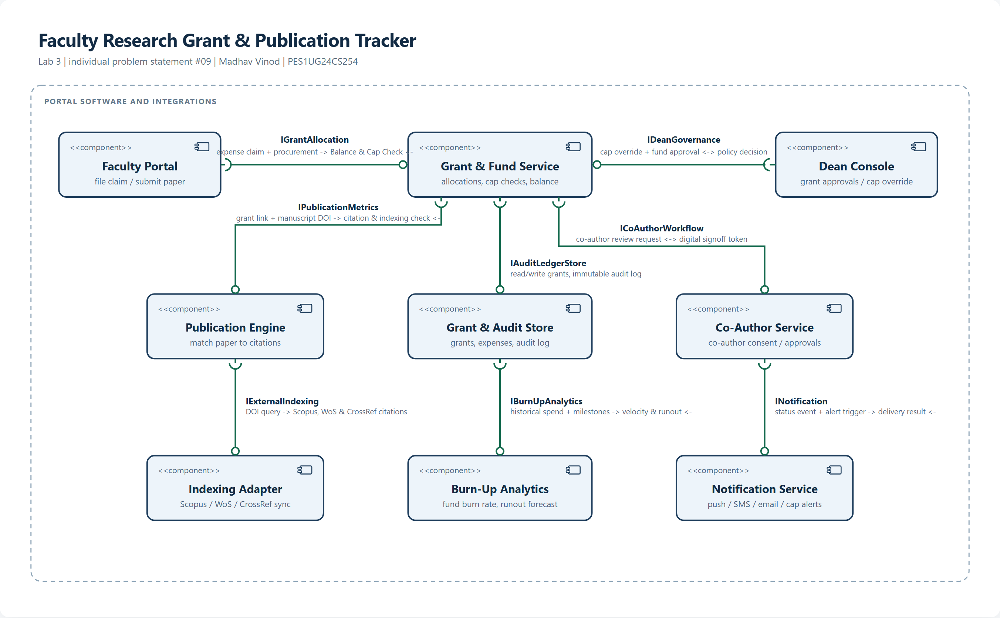

# Lab 3 · Component architecture

The faculty portal and Dean console both use the Grant & Fund Service. When a faculty member submits an invoice, that service checks the budget and passes an accepted debit to the Grant & Audit Store. Publication registration also crosses a service boundary. The Publication Engine resolves identifiers through the Indexing Adapter, and the Co-Author Service requests sign-off through the Notification Service.

- [Editable diagrams.net model](architecture.drawio) with nine movable components and eight named interfaces
- [Original vector drawing](../2-Architectural-Diagram/architecture_diagram.svg) with the assembly notation
- [Component responsibilities and interface contracts](../2-Architectural-Diagram/ARCHITECTURE_SPECIFICATION.md)
- [Standalone HTML viewer](../2-Architectural-Diagram/architecture_diagram.html)

Open the .drawio file with File → Open From → Device in diagrams.net. The connector labels match the interface names in the original drawing.
