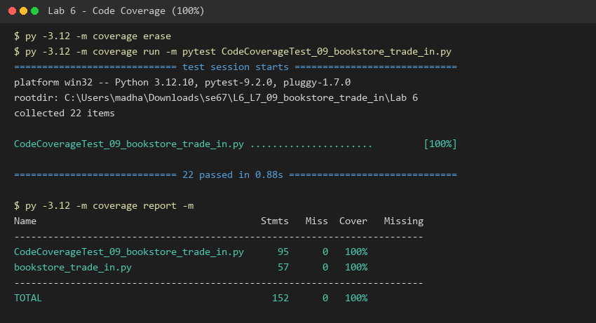
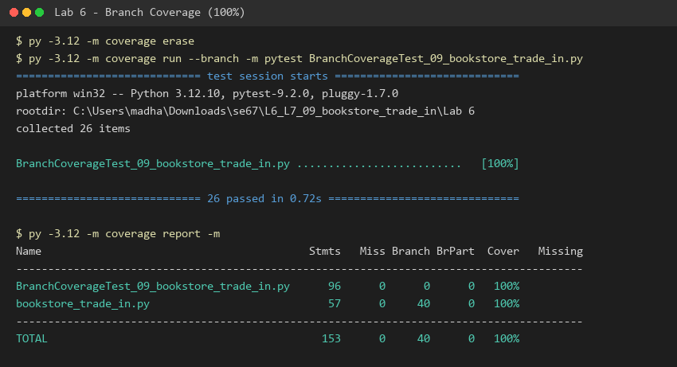

# L6_L7_09 — Bookstore Trade-In

**Lab 6: Code and Branch Coverage Analysis**

## About

A Python module that evaluates used book trade-in values across formats, wear conditions, and counterfeit alerts, and monitors optical barcode scanners for misread rates.

## Files

| File | Description |
|------|-------------|
| `bookstore_trade_in.py` | The module under test |
| `test_bookstore_trade.py` | Starter test file |
| `CodeCoverageTest_09_bookstore_trade_in.py` | Comprehensive test cases achieving **100% Code (Line) Coverage** |
| `BranchCoverageTest_09_bookstore_trade_in.py` | Targeted test cases achieving **100% Branch Coverage** |
| `FuzzTest_bookstore_trade_in.py` | Fuzz testing test cases using `hypothesis` (Lab 7) |
| `screenshots/` | Terminal output screenshots for coverage & fuzz testing |

---

## How to Run

### Code Coverage (Line Coverage)
```bash
coverage erase
coverage run -m pytest CodeCoverageTest_09_bookstore_trade_in.py
coverage report -m
```
Achieved: **100% Line Coverage**



---

### Branch Coverage
```bash
coverage erase
coverage run --branch -m pytest BranchCoverageTest_09_bookstore_trade_in.py
coverage report -m
```
Achieved: **100% Branch Coverage (40/40 branches)**


