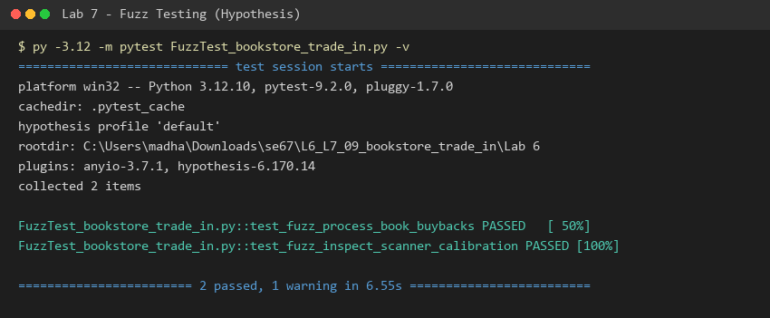

# Lab 7: Fuzz Testing

**Assigned Problem:** 09 - Bookstore Trade-In (`bookstore_trade_in.py`)  
**Methodology:** Automated property-based fuzz testing using `hypothesis`

---

## Overview

Fuzz testing feeds randomized, pseudo-random, edge-case, and malformed inputs to functions to evaluate system stability and resilience against unexpected crashes.

The test file `FuzzTest_bookstore_trade_in.py` tests two core workflows in `bookstore_trade_in.py`:
1. `process_book_buybacks(batch, store_credit_bonus)`:
   - Generates randomized book batches (varying `counterfeit`, `condition`, `missing_pages`, `format`, `intake_approved`, `payout_in_credit`).
   - Checks the result contains total_payout and status, or raises ValueError. The test normalizes missing-page and condition values before calling the module.
2. `inspect_scanner_calibration(scans_log)`:
   - Generates lists of scanner error-rate readings, including empty matrices and consecutive high readings.
   - Confirms calibration status (`NO_DATA`, `CALIBRATED`, `RECALIBRATE`) is handled correctly across full boundary spectra.

---

## Running the Tests

```bash
python -m pip install pytest hypothesis
python -m pytest FuzzTest_bookstore_trade_in.py -v
```

### Output:
```text
============================= test session starts =============================
platform win32 -- Python 3.12.10, pytest-9.2.0, pluggy-1.7.0
rootdir: C:\Users\madha\Downloads\se67\L6_L7_09_bookstore_trade_in\Lab 7
plugins: anyio-3.7.1, hypothesis-6.170.14
collected 2 items

FuzzTest_bookstore_trade_in.py::test_fuzz_process_book_buybacks PASSED   [ 50%]
FuzzTest_bookstore_trade_in.py::test_fuzz_inspect_scanner_calibration PASSED [100%]

======================== 2 passed, 1 warning in 6.55s =========================
```


